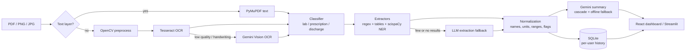

<div align="center">

# 🩺 MedLens AI
### Medical Report Information Extraction & Plain-Language Summarization

Turn lab reports, prescriptions and discharge summaries, whether digital PDFs, scans or photos, into **structured data**, **flagged findings** and a **patient-friendly summary**.


</div>

---

## Why this exists

Medical reports are hard to read. They arrive as scanned PDFs or phone photos, packed with abbreviations (`HGB`, `BID`, `1-0-1`), mixed units and reference ranges. Patients and caregivers are left guessing whether a value is fine or needs attention.

MedLens reads the document, works out what kind it is, pulls out the clinically relevant fields, **normalizes** them into one consistent schema, and explains the result in plain English. It never diagnoses and never invents advice: it is a reading aid, not a doctor.

## Highlights

- **Any input:** digital PDFs are parsed directly. Scanned PDFs and PNG/JPG photos go through OpenCV cleanup and Tesseract OCR, with **Gemini Vision** as a fallback for poor-quality or handwritten pages.
- **Three document types:** laboratory reports, prescriptions and hospital discharge summaries, auto-detected.
- **Hybrid extraction:** deterministic regex and table parsers come first, then scispaCy biomedical NER, with an LLM fallback only when the rules find little or nothing.
- **Normalization layer:** `wbc` / `leukocytes` / `white blood count` become *White Blood Cell Count*, units are harmonized, and reference ranges are parsed into min/max so flags can be computed from the numbers.
- **Grounded summaries:** the LLM is given the *normalized fields*, not raw OCR text, and is instructed to explain only what the report states.
- **Never a dead end:** the summary tries a Gemini model cascade (`flash-lite`, then `flash`, then a third model), then falls back to an offline rule-based summary if no key or service is available.
- **Health history:** compare the same biomarker across dated reports with delta changes and trend charts.
- **Two interfaces:** a React dashboard (**MedLens**) and a Streamlit app for inspecting the pipeline.
- **Measured, not assumed:** an automated 11-document benchmark with ground truth reports classification accuracy, field-level precision/recall/F1, abnormal-flag sensitivity/specificity, latency and memory.

## How it works



| Stage | Folder | What it does |
|---|---|---|
| Ingestion | `ingestion/` | PDF text detection and extraction (PyMuPDF), grayscale/denoise/threshold (OpenCV), OCR (Tesseract, Gemini Vision fallback) |
| Classification | `classification/` | Keyword scoring across `lab` / `prescription` / `discharge`; Gemini fallback when no keyword matches |
| Extraction | `extraction/` | Lab values (colon, tabular and pipe-table formats, with a demographic-header filter), prescriptions (drug, dose, frequency, duration), discharge sections (diagnosis, procedures, follow-up) |
| Normalization | `normalization/` | Canonical test and drug names, unit harmonization, typed dataclasses `LabResult`, `PrescriptionItem`, `DischargeInfo` |
| Summarization | `summarization/` | Grounding prompts, model cascade, offline fallback |
| API | `api/` | FastAPI service and SQLite persistence |
| UI | `frontend/`, `app/` | React + Tailwind dashboard, Streamlit app |
| Evaluation | `eval/`, `performance_metrics_evaluation/` | Ground-truth scoring and the 11-document benchmark |

## The MedLens dashboard

| View | What you get |
|---|---|
| **Login / profile** | Demo-grade accounts with a profile (name, DOB, blood group, MRN) and a seeded demo user |
| **Home** | Latest report with *What looks normal* and *What may need attention* callouts, plus a key-marker table |
| **Upload** | Drag-and-drop for PDF/PNG/JPG, one-click bundled samples, and a live pipeline progress indicator |
| **My Reports** | Searchable, filterable report library with the original text viewable and report deletion |
| **Health History** | Biomarker comparison across dates with deltas and trend charts |
| **Settings** | Text size, summary style (concise, standard, in-depth) and language preference |

## Quick start

### Prerequisites
- Python 3.11 or 3.12 and Node.js 18+
- **Tesseract OCR binary** (installed separately from the Python package):
  Windows: [UB-Mannheim installer](https://github.com/UB-Mannheim/tesseract/wiki) · macOS: `brew install tesseract` · Ubuntu: `sudo apt install tesseract-ocr`
- A [Google Gemini API key](https://aistudio.google.com/) (optional but recommended; without it the app uses offline fallbacks)

### 1. Backend
```bash
git clone https://github.com/Sandhiya-003/medical-report-extractor.git
cd medical-report-extractor

python -m venv venv
venv\Scripts\activate            # Windows
# source venv/bin/activate       # macOS / Linux

pip install -r requirements.txt
pip install fastapi google-genai # used by the code; add to requirements.txt if missing
```

Create a `.env` file in the project root:
```env
GEMINI_API_KEY=your_key_here
```

Check your setup (imports, Tesseract, Gemini key, scispaCy model):
```bash
python test_setup.py
```

Start the API on port 8000:
```bash
python -m uvicorn api.server:app --port 8000 --reload
```
Interactive API docs: http://127.0.0.1:8000/docs

If Tesseract is not on your `PATH`, set `pytesseract.pytesseract.tesseract_cmd` in `ingestion/ocr.py`.

### 2. Frontend
```bash
cd frontend
npm install
npm run dev
```
Open http://localhost:5173. The frontend calls the API at `http://127.0.0.1:8000` (set in `frontend/src/api.js`).

### Or: the Streamlit app
```bash
streamlit run app/streamlit_app.py     # http://localhost:8501
```
Four tabs let you inspect each stage: **Raw Text**, **Extracted Fields**, **Plain-Language Summary** and **Flagged Items**.

## API

| Method | Endpoint | Purpose |
|---|---|---|
| `GET` | `/api/health` | Service status |
| `POST` | `/api/analyze` | Upload a PDF/PNG/JPG, run the pipeline, save the report for the user |
| `GET` | `/api/samples` · `POST /api/samples/analyze` | List and analyze the bundled synthetic samples |
| `GET` | `/api/reports` · `/api/reports/{id}` | List a user's reports or fetch one |
| `DELETE` | `/api/reports/{id}` | Delete a report |
| `GET` | `/api/history/comparison` | Biomarker comparison across a user's reports |
| `POST` | `/api/auth/sync` | Create or fetch a user record |
| `PUT` | `/api/user/profile` | Update profile details |

Errors are explicit: unsupported or empty files return `400`, and documents with no recognizable medical content return `422` with a clear message.

## Evaluation

Run the automated benchmark (11 documents with ground-truth JSON: 4 lab reports, 4 prescriptions, 3 discharge summaries):
```bash
python performance_metrics_evaluation/run_performance_tests.py
```
Regenerate the test PDFs and ground truth with `performance_metrics_evaluation/generators/generate_fake_reports.py`.

| Dimension | Metric | Result |
|---|---|---|
| Classification | Accuracy / macro-F1 | **100%** (11/11) / **1.00** |
| Extraction | Field precision / recall / F1 | **0.966** (142 TP, 5 FP) / **1.000** / **0.983** |
| Extraction | Exact-match rate | **100%** |
| Flag detection | Sensitivity / specificity | **100%** (10/10) / **100%** (7/7) |
| Summarization | Generation success / key-concept retention | **100%** / **100%** |
| Speed | Mean end-to-end latency | **11.6 s** per document (5.2 docs/min) |
| Memory | Peak RAM | **69 MB** |

Full outputs are in [`performance_metrics_evaluation/results/`](performance_metrics_evaluation/results/) (Markdown report, JSON, CSV, confusion matrix).

> **Read these numbers honestly.** The benchmark documents are synthetic and were produced by this project's own generator, so the clean results show the pipeline works on well-formed layouts, **not** how it will perform on real-world reports. Latency includes Gemini API calls and is above the 5 s target in the benchmark report.

There is also a second ground-truth workflow in `eval/`: `eval/annotate.py` drafts annotations from pipeline output (marked `"verified": false`), you correct them, and `eval/metrics.py` scores only verified files so the pipeline is never graded on its own unreviewed output.

## Privacy and safety

- **Informational only.** It does not diagnose, prescribe or replace a clinician. Always check results against the original report.
- **All bundled data is synthetic.** No real patient information was used to build or test this project.
- **Data leaves your machine in some cases.** When enabled, report text or normalized fields are sent to the Google Gemini API for summaries, LLM fallbacks and handwriting OCR. Do not use real patient records without checking your privacy obligations (for example HIPAA or GDPR).
- **Reports are stored locally.** Processed reports (including extracted text) are saved in a local SQLite database (`data/medlens.db`, git-ignored).

## Known limitations

- **Authentication is demo-grade.** The login form is handled in the browser and the API identifies users by email, with no tokens or password verification, and CORS is open (`*`). Do not expose it publicly or use real data until proper authentication and access control are added.
- Classification is a keyword heuristic (with an LLM fallback), not a trained model.
- Term and unit mapping uses hardcoded dictionaries, not RxNorm or LOINC.
- Photographed pages are not deskewed, and mixed-content documents (for example a discharge summary with an embedded lab table) are handled as a single type.
- `requirements.txt` is UTF-16 encoded and does not list every runtime dependency (`fastapi`, `google-genai`).

## Roadmap

- [ ] Real authentication (hashed passwords, JWT/session) and per-user authorization
- [ ] RxNorm and LOINC lookups for drug and test normalization
- [ ] Trained document classifier
- [ ] Deskewing and layout analysis for phone photos
- [ ] Mixed-content and multi-page report handling
- [ ] Larger, more varied ground-truth set, including de-identified real-world layouts
- [ ] Docker Compose setup and CI running the test suites

## Project structure

```
medical-report-extractor/
├── api/                          # FastAPI server + SQLite layer
├── app/                          # Streamlit app
├── classification/               # Document-type classifier
├── data/samples/                 # Synthetic lab / prescription / discharge / edge-case files
├── eval/                         # Ground-truth annotation + metrics, full-pipeline checks
├── extraction/                   # Lab, prescription, discharge extractors, NER, section splitter
├── frontend/                     # React 19 + Vite + Tailwind dashboard
├── ingestion/                    # PDF parsing, image preprocessing, OCR
├── normalization/                # Schemas, term/unit mapping
├── performance_metrics_evaluation/   # 11-document benchmark (generator, evaluator, results)
├── summarization/                # Prompts + Gemini client with fallbacks
├── project_architecture_summary.md   # Deeper architecture write-up
└── test_setup.py                 # Environment check
```

Each stage also has its own test script, for example `python ingestion/test_ingestion.py`, `python extraction/test_extraction.py` and `python normalization/test_normalization.py`.
