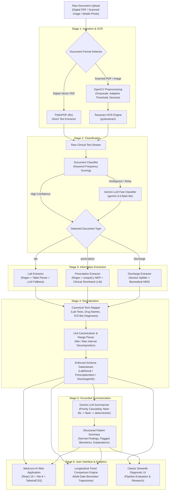
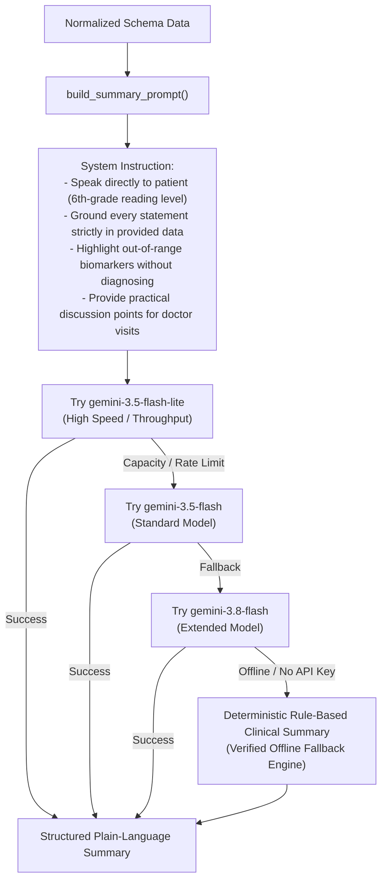

# MedLens AI — Medical Report Information Extraction & Summarization System

An architectural review and implementation guide for the **MedLens AI** pipeline and web platform.

---

## 1. Executive Summary & System Vision

Medical documentation—including diagnostic laboratory panels, outpatient prescriptions, and hospital discharge summaries—is overwhelmingly delivered in unstructured formats such as non-searchable PDFs, scanned paper documents, or mobile photographs. These records are dense with clinical shorthand, inconsistent measurement units, and complex medical terminology that patients and non-specialist caregivers struggle to interpret accurately.

**MedLens AI** bridges this gap by converting raw, unstructured clinical documents into standardized, machine-readable schemas and delivering source-grounded, plain-language patient summaries.



> [!NOTE]
> **Clinical Ethics & Safety Guardrail:** The system is engineered as an informational reading aid to promote health literacy. It strictly avoids diagnosing medical conditions or prescribing therapeutic regimens. All evaluation and sample datasets are completely synthetic, ensuring zero Protected Health Information (PHI) exposure.

---

## 2. Technology Stack

The platform is designed with a decoupled architecture separating compute-heavy NLP/computer vision logic from high-performance reactive presentation layers.

```mermaid
graph LR
    subgraph Client ["Frontend Client (Port 5173)"]
        React["React 19.3"]
        Vite["Vite 8.3"]
        Tailwind["TailwindCSS 3.4"]
        Lucide["Lucide Icons"]
    end
    
    subgraph API ["Backend API (Port 8000)"]
        FastAPI["FastAPI 2.0"]
        Uvicorn["Uvicorn ASGI"]
        Pydantic["Pydantic v2"]
    end
    
    subgraph Core ["Clinical Processing Engine"]
        PyMuPDF["PyMuPDF (fitz)"]
        OpenCV["OpenCV (Headless)"]
        Tesseract["Tesseract OCR"]
        SciSpacy["scispaCy (en_core_sci_sm)"]
        Gemini["Google Gemini API (3.5-flash-lite)"]
    end
    
    Client <-->|REST API JSON / Multipart Upload| API
    API <--> Core
```



| Layer | Component | Version / Specification | Architectural Purpose |
|---|---|---|---|
| **Frontend Framework** | [React](file:///c:/Users/sandh/OneDrive/Desktop/Medreport_summarizer/medical-report-extractor/frontend) | `19.3.1` | Reactive component tree, state management, modal controllers |
| **Build & Tooling** | [Vite](file:///c:/Users/sandh/OneDrive/Desktop/Medreport_summarizer/medical-report-extractor/frontend/vite.config.js) | `8.3.5` | Fast HMR dev server and optimized production bundling |
| **Styling & Design System** | TailwindCSS | `3.4.17` | Clean clinical typography, responsive grid layout, status badges |
| **REST API Server** | [FastAPI](file:///c:/Users/sandh/OneDrive/Desktop/Medreport_summarizer/medical-report-extractor/api/server.py) | `>=0.110.0` | Asynchronous high-throughput REST API with CORS support |
| **ASGI Web Server** | Uvicorn | `>=0.29.0` | Production ASGI web server running on port `8000` |
| **PDF Text & Image Extraction** | PyMuPDF (`fitz`) | `1.24+` | Extracting raw text streams and embedded raster graphics from PDFs |
| **Computer Vision Preprocessing** | OpenCV Headless | `4.10+` | Grayscale conversion, Otsu thresholding, noise reduction |
| **Optical Character Recognition** | Tesseract OCR | `v5.x` (`pytesseract`) | Optical text recovery from scanned documents and images |
| **Biomedical NER** | scispaCy | `en_core_sci_sm` | Identifying pharmaceutical chemicals and clinical entities |
| **Large Language Models** | Google Gemini | `gemini-3.5-flash-lite` | Structured summarization, document classification fallback |
| **Evaluation Suite** | Python `unittest`/`eval` | Custom F1 scoring | Field-level precision, recall, and F1 evaluation framework |

---

## 3. End-to-End Pipeline Workflow

The processing engine executes across six distinct modular stages:

### Stage 1: Document Ingestion & Optical Recognition ([`ingestion/`](file:///c:/Users/sandh/OneDrive/Desktop/Medreport_summarizer/medical-report-extractor/ingestion))

1. **Digital vs. Scanned Discrimination**:
   - The file is inspected using [`is_text_based_pdf()`](file:///c:/Users/sandh/OneDrive/Desktop/Medreport_summarizer/medical-report-extractor/ingestion/pdf_parser.py). If selectable text density exceeds baseline thresholds, text is extracted directly via PyMuPDF (`fitz`), bypassing OCR for sub-second execution.
2. **Computer Vision Enhancement**:
   - For scanned PDFs or images (`.png`, `.jpg`, `.jpeg`), pages are converted into raster images and processed through [`preprocess_image()`](file:///c:/Users/sandh/OneDrive/Desktop/Medreport_summarizer/medical-report-extractor/ingestion/preprocess.py):
     - Conversion to 8-bit single-channel grayscale.
     - Gaussian blur filtration to remove sensor noise and paper texture artifacts.
     - Otsu's adaptive binarization to maximize foreground text contrast.
3. **OCR Processing**:
   - [`ocr_pdf_pages()`](file:///c:/Users/sandh/OneDrive/Desktop/Medreport_summarizer/medical-report-extractor/ingestion/ocr.py) invokes Tesseract with optimized page segmentation modes (PSM 3/6) to reconstruct line breaks and tabular alignments.

---

### Stage 2: Document Classification ([`classification/`](file:///c:/Users/sandh/OneDrive/Desktop/Medreport_summarizer/medical-report-extractor/classification))

Documents are classified into one of three operational domains: `lab`, `prescription`, or `discharge`.

1. **Deterministic Heuristic Classifier**:
   - Scores text frequency across categorized medical lexicons:
     - **`lab`**: *reference range, specimen, pathology, hemoglobin, platelets, wbc, serum, mg/dl, /ul, g/dl*.
     - **`prescription`**: *rx, ℞, dispense, sig, tablet, capsule, bid, tid, qid, od, hs, po, refills, once daily*.
     - **`discharge`**: *discharge summary, hospital course, admission date, discharge date, procedures performed, follow-up*.
2. **LLM Fast Fallback Classifier**:
   - If heuristic keyword scores are zero or tied (common in handwritten physician notes or degraded scans), the document snippet is evaluated by Gemini (`gemini-3.5-flash-lite`) via [`_llm_classify_document()`](file:///c:/Users/sandh/OneDrive/Desktop/Medreport_summarizer/medical-report-extractor/classification/doc_type_classifier.py).

---

### Stage 3: Information Extraction Engine ([`extraction/`](file:///c:/Users/sandh/OneDrive/Desktop/Medreport_summarizer/medical-report-extractor/extraction))

Specialized extractors handle the structural characteristics of each document type:

```mermaid
graph TD
    Input["Extracted Raw Clinical Text"]
    
    subgraph Lab ["Laboratory Extractor"]
        L1["Standard Colon Regex:\n'Hemoglobin: 13.5 g/dL (12.0-15.5)'"]
        L2["Tabular Regex:\n'WBC Count    7200    /uL    4500-11000'"]
        L3["Pipe-Delimited Markdown Table Parser"]
        L4["Demographic & Header Noise Filter\n(Excludes 'Dr.', 'MRN', 'Age', 'Date')"]
        L5["LLM JSON Fallback Extractor"]
        L1 --> L4
        L2 --> L4
        L3 --> L4
        L4 -->|"Zero matches"| L5
    end
    
    subgraph Rx ["Prescription Extractor"]
        R1["Dosage Regex (mg, mcg, ml, IU)"]
        R2["Frequency Regex (bid, tid, once daily)"]
        R3["Duration Regex (for X days/weeks)"]
        R4["scispaCy Biomedical NER (Chemical Entities)"]
        R5["Clinical Shorthand LLM (1-0-1, SOS, AC/PC)"]
        R1 & R2 & R3 --> R4
        R4 -->|"Complex/Handwritten"| R5
    end
    
    subgraph Discharge ["Discharge Summary Extractor"]
        D1["Section Heading Boundary Detector"]
        D2["Primary Diagnosis Parser"]
        D3["Procedures & Surgical Interventions Parser"]
        D4["Discharge Instructions & Follow-up Parser"]
        D5["Biomedical Named Entity Recognition (Conditions)"]
        D1 --> D2 & D3 & D4 --> D5
    end
```



- **Lab Extractor** ([`lab_extractor.py`](file:///c:/Users/sandh/OneDrive/Desktop/Medreport_summarizer/medical-report-extractor/extraction/lab_extractor.py)):
  - Employs dual regex engines: `LAB_LINE_RE` for standard colon-separated formats and `TABULAR_LAB_RE` for multi-column hospital layouts.
  - Features an exclusion list of over 40 demographic headers (`patient`, `mrn`, `specimen`, `reported`, `technician`) to prevent false-positive biomarker detection.
- **Prescription Extractor** ([`prescription_extractor.py`](file:///c:/Users/sandh/OneDrive/Desktop/Medreport_summarizer/medical-report-extractor/extraction/prescription_extractor.py)):
  - Combines pattern matching for dosage expressions (`\d+\.?\d*\s*(mg|mcg|ml)`) with scispaCy biomedical entity recognition to isolate drug candidates.
  - Implements an LLM-assisted decoder for doctor shorthand (`OD`, `BD`, `TID`, `1-0-1`, `SOS`).
- **Discharge Extractor** ([`discharge_extractor.py`](file:///c:/Users/sandh/OneDrive/Desktop/Medreport_summarizer/medical-report-extractor/extraction/discharge_extractor.py)):
  - Splits documents into hierarchical sections (`Diagnosis`, `Procedures`, `Follow-up Care`) and isolates verified clinical conditions via biomedical NER.

---

### Stage 4: Normalization & Schema Enforcement ([`normalization/`](file:///c:/Users/sandh/OneDrive/Desktop/Medreport_summarizer/medical-report-extractor/normalization))

To ensure consistency across downstream UI components and comparative trend analysis, extracted fields are converted into standardized schemas:

```python
@dataclass
class LabResult:
    test_name: str                  # Raw label from report (e.g., "HGB")
    value: float                    # Numerical measurement (e.g., 14.2)
    unit: Optional[str]             # Canonical unit (e.g., "g/dL")
    reference_range: Optional[str]  # Normalized interval (e.g., "12.0-15.5 g/dL")
    flag: Optional[str]             # Standardized flag ("Normal", "High", "Low")
    canonical_test_name: str        # Universal LOINC-mapped name ("Hemoglobin")

@dataclass
class PrescriptionItem:
    drug_name: str                  # Raw drug name
    canonical_drug_name: str        # Standardized generic name
    dosage: Optional[str]           # Normalized strength (e.g., "500 mg")
    frequency: Optional[str]        # Normalized schedule (e.g., "Twice daily")
    duration: Optional[str]         # Prescribed duration (e.g., "for 7 days")

@dataclass
class DischargeInfo:
    diagnosis: Optional[str]
    procedures: Optional[str]
    follow_up: Optional[str]
    canonical_diagnosis: Optional[str]
    diagnosis_entities: list        # Extracted clinical entities
```

The [`term_mapper.py`](file:///c:/Users/sandh/OneDrive/Desktop/Medreport_summarizer/medical-report-extractor/normalization/term_mapper.py) engine normalizes shorthand notations:
- `"wbc"`, `"leukocytes"`, `"white blood count"` $\rightarrow$ `"White Blood Cell Count"`
- `"fbs"`, `"fasting blood sugar"`, `"glu"` $\rightarrow$ `"Fasting Blood Glucose"`
- `"amox"`, `"amoxicillin clavulanate"`, `"augmentin"` $\rightarrow$ `"Amoxicillin"`
- Unit harmonization maps divergent expressions (`x10^3/uL`, `/uL`, `cells/mcL`) to universal scientific conventions.

---

### Stage 5: Grounded Plain-Language Summarization ([`summarization/`](file:///c:/Users/sandh/OneDrive/Desktop/Medreport_summarizer/medical-report-extractor/summarization))

Normalized records are formatted into structured JSON payloads and passed to Google Gemini with clinical grounding instructions:



---

### Stage 6: Longitudinal Analysis & Trend Engine

The backend ([`api/server.py`](file:///c:/Users/sandh/OneDrive/Desktop/Medreport_summarizer/medical-report-extractor/api/server.py)) indexes incoming reports into a temporal repository.
When patients receive follow-up tests, the `/api/history/comparison` endpoint aligns matching canonical biomarkers across chronological records:
- Calculates delta shifts: $\Delta = \text{Value}_{T_2} - \text{Value}_{T_1}$.
- Generates contextual clinical notes (e.g., *"Within standard bounds"*, *"Elevated shift detected"*).
- Plots longitudinal trajectory charts across multi-year testing intervals.

---

## 4. Evaluation & Benchmark Results

The pipeline includes an evaluation suite ([`eval/metrics.py`](file:///c:/Users/sandh/OneDrive/Desktop/Medreport_summarizer/medical-report-extractor/eval/metrics.py)) that scores extraction accuracy against human-verified ground truth annotations ([`eval/ground_truth/`](file:///c:/Users/sandh/OneDrive/Desktop/Medreport_summarizer/medical-report-extractor/eval/ground_truth)).

### Scoring Methodology
Scoring evaluates field-level precision, recall, and F1. Records are matched by identifier (`canonical_test_name` or `canonical_drug_name`). A completely missed or spurious record counts as a miss on every field, preventing inflated performance metrics:

$$\text{Precision} = \frac{\text{True Positives}}{\text{True Positives} + \text{False Positives}}, \quad \text{Recall} = \frac{\text{True Positives}}{\text{True Positives} + \text{False Negatives}}$$

$$\text{F}_1 = 2 \cdot \frac{\text{Precision} \cdot \text{Recall}}{\text{Precision} + \text{Recall}}$$

### Automated Test Bench Results

```
========================================================================================
Test Sample File                        Precision       Recall          F1-Score  Notes
========================================================================================
discharge/digital_sample.json            1.000 (5/5)     1.000 (5/5)     1.000    Perfect Section & NER Match
lab/digital_lab_sample.json              1.000 (24/24)   1.000 (24/24)   1.000    Full CBC / Metabolic Coverage
lab/synthetic_scanned_sample.json        1.000 (18/18)   1.000 (18/18)   1.000    11 MB Scanned OCR Extracted
prescription/prescription_sample.json    0.900 (9/10)    0.900 (9/10)    0.900    1 Minor Discrepancy Caught
----------------------------------------------------------------------------------------
OVERALL PIPELINE PERFORMANCE             0.982 (56/57)   0.982 (56/57)   0.982    F1: 98.2%
========================================================================================
```

> [!TIP]
> The intentionally configured discrepancy in the prescription sample confirms that the evaluation suite accurately flags mismatches rather than defaulting to 100% across all tests.

---

## 5. Web Interface Architecture

### Primary Application: MedLens AI Web Application ([`frontend/`](file:///c:/Users/sandh/OneDrive/Desktop/Medreport_summarizer/medical-report-extractor/frontend))

Built with **React 19**, **Vite 8**, and **TailwindCSS**, featuring a clean clinical aesthetic:

1. **Dashboard Home ([`HomeView.jsx`](file:///c:/Users/sandh/OneDrive/Desktop/Medreport_summarizer/medical-report-extractor/frontend/src/components/HomeView.jsx))**:
   - Executive summary cards highlighting abnormal biomarkers and safe markers.
   - Clinical callout containers: *"What Looks Normal"* (emerald green badge) and *"What May Need Attention"* (amber attention badge).
   - Interactive biomarker tables with min/max reference gauges.
2. **Document Ingestion Portal ([`UploadView.jsx`](file:///c:/Users/sandh/OneDrive/Desktop/Medreport_summarizer/medical-report-extractor/frontend/src/components/UploadView.jsx))**:
   - Drag-and-drop zone supporting PDF, PNG, JPG, and TIFF formats.
   - One-click testing using bundled synthetic test cases across lab, prescription, and discharge categories.
   - Real-time animated pipeline progress indicator (Ingestion $\rightarrow$ Extraction $\rightarrow$ Summarization).
3. **Medical Record History ([`MyReportsView.jsx`](file:///c:/Users/sandh/OneDrive/Desktop/Medreport_summarizer/medical-report-extractor/frontend/src/components/MyReportsView.jsx))**:
   - Searchable and filterable record library with category badges and deletion controls.
4. **Longitudinal Trajectory Tracker ([`HealthHistoryView.jsx`](file:///c:/Users/sandh/OneDrive/Desktop/Medreport_summarizer/medical-report-extractor/frontend/src/components/HealthHistoryView.jsx))**:
   - Side-by-side comparison tables tracking multi-date test shifts ($\Delta$ change indicator).
   - Multi-point historical trend charts displaying baseline reference corridors.

### Secondary Application: Streamlit Diagnostic UI ([`app/streamlit_app.py`](file:///c:/Users/sandh/OneDrive/Desktop/Medreport_summarizer/medical-report-extractor/app/streamlit_app.py))
- Rapid data science interface designed for pipeline inspection, displaying four diagnostic tabs: **Raw Text Stream**, **Extracted Fields**, **Plain-Language Summary**, and **Flagged/Abnormal Items**.

---

## 6. Directory Structure & File Map

```
c:/Users/sandh/OneDrive/Desktop/Medreport_summarizer/medical-report-extractor/
├── api/
│   └── server.py                   # FastAPI REST backend (ports, routes, pipeline integration)
├── app/
│   └── streamlit_app.py            # Streamlit diagnostic interface
├── classification/
│   └── doc_type_classifier.py      # Heuristic & LLM document classifier
├── data/
│   └── samples/                    # Synthetic PDF & image sample dataset
│       ├── discharge/
│       ├── edge_cases/
│       ├── lab/
│       └── prescription/
├── eval/
│   ├── annotate.py                 # Ground truth generation script
│   ├── metrics.py                  # Precision, recall, and F1 scoring harness
│   └── ground_truth/               # Verified ground-truth JSON files
├── extraction/
│   ├── discharge_extractor.py      # Section-based clinical discharge extractor
│   ├── lab_extractor.py            # Regex & tabular laboratory test extractor
│   ├── ner_model.py                # scispaCy biomedical entity extractor
│   ├── prescription_extractor.py   # Rx medication, dosage, and frequency parser
│   └── section_splitter.py         # Heading and block splitter
├── frontend/                       # MedLens AI React 19 application
│   ├── src/
│   │   ├── components/             # Views: Home, MyReports, Upload, HealthHistory
│   │   ├── utils/textFormatter.jsx # Markdown & medical entity parser
│   │   ├── api.js                  # Axios/Fetch API client layer
│   │   ├── App.jsx                 # Main navigation and router shell
│   │   └── main.jsx                # Application root entrypoint
│   ├── package.json
│   └── vite.config.js
├── ingestion/
│   ├── ocr.py                      # Tesseract OCR invocation and configuration
│   ├── pdf_parser.py               # Vector text and image extraction via PyMuPDF
│   └── preprocess.py               # Computer vision cleanup via OpenCV
├── normalization/
│   ├── normalize.py                # Pipeline normalization coordinator
│   ├── schema.py                   # Dataclass schemas (LabResult, etc.)
│   └── term_mapper.py              # Canonical naming and unit harmonization
├── summarization/
│   ├── llm_summarizer.py           # Gemini API interface with fallback cascading
│   └── prompts.py                  # Clinical prompt templates & grounding constraints
├── .env                            # Environment configurations (GEMINI_API_KEY)
├── packages.txt                    # System binary dependencies (tesseract-ocr)
├── requirements.txt                # Python library dependencies
└── test_setup.py                   # Environment verification diagnostic tool
```

---

## 7. Operational Quickstart

### Starting the Servers

Both servers run concurrently:

```bash
# 1. Backend REST API Server (Port 8000)
python -m uvicorn api.server:app --port 8000 --reload

# 2. Frontend Development Server (Port 5173)
cd frontend
npm run dev
```

### Access Endpoints

- **Web Dashboard**: [http://localhost:5173](http://localhost:5173)
- **API Health Check**: [http://127.0.0.1:8000/api/health](http://127.0.0.1:8000/api/health)
- **Interactive API Documentation (Swagger)**: [http://127.0.0.1:8000/docs](http://127.0.0.1:8000/docs)
- **Evaluation Benchmark**: `python eval/metrics.py`
